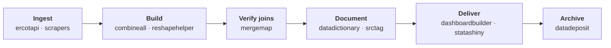

<h1 align="center">Eric A. Booth</h1>

<p align="center">
  <b>Researcher &middot; Evaluation Specialist &middot; Statistical Programmer</b><br>
  <sub>Monitoring, Evaluation &amp; Learning &nbsp;|&nbsp; Austin, TX &nbsp;|&nbsp; <a href="https://texas2036.org">Texas&nbsp;2036</a></sub><br>
  <sub><i>Alchemizing &#9749; caffeine into Stata code</i></sub>
</p>

<p align="center">
  
  
  
  
  
  
</p>

<p align="center">
  <a href="https://ericabooth.github.io/code-portfolio/"></a>
  <a href="https://econpapers.repec.org/RAS/pbo536.htm#author-software"></a>
  <a href="https://scholar.google.com/citations?user=dX8xU4UAAAAJ&hl=en"></a>
  <a href="https://orcid.org/0000-0001-9607-5979"></a>
  <a href="https://www.linkedin.com/in/eric-booth-746376a"></a>
</p>

---

Two decades in **Monitoring, Evaluation and Learning**, working where complex statistical
programming meets applied policy research. I build the evidence base for state, federal and
foundation-funded programs in **education, behavioral health and juvenile justice** — and I build
the tooling that makes that work reproducible. Currently at the non-partisan policy think tank
**Texas 2036**, on data-driven policy for the state.

### One toolkit, end to end



<sub>Diagrams like this are what <code>mergemap</code> emits for a real pipeline &mdash; as mermaid, SMCL, HTML, PNG or DOT.</sub>

### Start here

**[→ The code portfolio](https://ericabooth.github.io/code-portfolio/)** — every tool I maintain,
searchable by the problem it solves, with a gallery of what ten of the packages actually produce.

### A few of the packages

| Package | What it does | Install |
|---|---|---|
| `mergemap` | Maps every join in a do-file and what each one did to the row count | [GitHub](https://github.com/ericabooth/mergemap-stata-public) |
| `surveymap` | Survey flow maps that count answers, refusals and skip-logic skips separately | [GitHub](https://github.com/ericabooth/surveymap-stata-public) |
| `datadeposit` | Archive-ready copies of a dataset for Stata, R and Python in one step | [GitHub](https://github.com/ericabooth/datadeposit) |
| `peerpick` | Picks a comparison group for one unit, then tests how much that choice mattered | [GitHub](https://github.com/ericabooth/peerpick-stata-public) |
| `dashboardbuilder` | Self-contained interactive HTML dashboards, written from a do-file | `ssc install dashboardbuilder` |
| `statashiny` | Shiny-style widgets that recompute in the browser | `ssc install statashiny` |
| `googlesheets` | Read, write and format Google Sheets without leaving Stata | `ssc install googlesheets` |
| `statplot` | Plots of summary statistics, by category *(with Nicholas J. Cox)* | `ssc install statplot` |

<details>
<summary><b>See it in use</b></summary>

<br>

```stata
* map every join across a pipeline, run it, and report what each one did to N
mergemap run 01_clean.do 02_merge.do 03_analyze.do

* build a self-contained interactive dashboard from the do-file itself
dashboardbuilder init  , title("State explorer") selector(state) refvalue("United States")
dashboardbuilder panel kpi , values(pop medage) title("Headline numbers")
dashboardbuilder build using "state_explorer.html", replace pdf truepdf

* hand off an archive-ready copy that opens in Stata, R or Python
datadeposit, to(survey_deposit) title("Spring 2026 resident survey") replace
```

</details>

<details>
<summary><b>Demo sites &amp; galleries</b></summary>

<br>

| Gallery | What it shows |
|---|---|
| [mergemap](https://ericabooth.github.io/code-portfolio/galleries/mergemap/) | Every `mergemap` output from one pipeline: the receipt, the map as SMCL / HTML / PNG / mermaid / DOT, and run mode with observed counts |
| [surveymap](https://ericabooth.github.io/code-portfolio/galleries/surveymap/) | Survey flow maps and response braids, with answers, refusals and skips counted separately |
| [Webdoc2](https://ericabooth.github.io/Webdoc2_Example_Site/) | Interactive websites generated from Stata do-files |
| [Sparkta2](https://ericabooth.github.io/Sparkta2_Example_Site/) | Interactive small-multiple and county maps from Stata |
| [StataShiny](https://ericabooth.github.io/StataShiny_Example_Site/) | Simulations, interactive visualizations and web tables written from Stata |
| [GoogleChart](https://ericabooth.github.io/GoogleChart_Example_Site/) | Google Charts and Google Sheets driven from Stata |
| [DashboardBuilder](https://ericabooth.github.io/dashboardbuilder_Example_Site/) | HTML/JS dashboards built from do-files; embeds webdoc2, sparkta2 and statashiny output |

</details>

<details>
<summary><b>Background &amp; expertise</b></summary>

<br>

**Now:** Texas 2036 — data modernization and advanced analytics for state policy.

**Previously:** Senior Director of Research and President at Far Harbor, LLC (promoted from
Sr. Statistician, 2020) · Research Faculty at the Texas A&amp;M Public Policy Research Institute ·
Lecturer in Health Policy &amp; Management at Texas A&amp;M, teaching graduate research methods and
statistical programming · Senior Research Scientist at Gibson Consulting Group. Affiliated
researcher with the Texas Education Research Center and the Southwest Regional Education
Laboratory (REL).

**Selected impact.** Published in the *Journal of Developmental Education*, *Party Politics*,
*American Journal of Public Health* and the *Journal of Applied Research on Children*; co-author of
a book from Teachers College Press; 80+ technical and evaluation reports. The CSG-sponsored study
*Breaking Schools' Rules* provided statewide longitudinal analysis of school discipline and juvenile
justice placement that informed state and federal legislative change, and was cited as a motivating
study for President Obama's *My Brother's Keeper* initiative.

**Core expertise**
- **Statistical programming** — expert-level Stata (active SSC contributor) and Python; working R, SAS and NVivo.
- **Complex modeling** — multilevel models, panel data, sampling weights, nonresponse bias sensitivity; LASSO and related ML.
- **Workflow automation** — reproducible end-to-end pipelines, from raw data to analytic dataset to deliverable.
- **Study design** — lead investigator on large longitudinal studies and RCTs, including designs built for messy collection and hard-to-retain participants.

**Teaching.** Workshops on applied evaluation, including AI-assisted methods — most recently the
NSF-funded *Research in Excellence* workshop at Prairie View A&amp;M and the Texas Evaluation Network
annual meeting.

**Data advocacy.** State-level data modernization and data-rescue work: harmonization,
machine-readability and transparency in public reporting.

</details>

<details>
<summary><b>Elsewhere</b></summary>

<br>

- **Website:** [www.eric-booth.com](https://sites.google.com/site/ericabooth/cv/mycv)
- **Email:** [eric.a.booth@gmail.com](mailto:eric.a.booth@gmail.com)
- **RePEc / SSC:** [software and papers](https://econpapers.repec.org/RAS/pbo536.htm#author-software)
- **OSF:** [osf.io/2n4k7](https://osf.io/2n4k7/)
- **Statalist:** [active member and contributor](https://www.statalist.org/)

</details>
